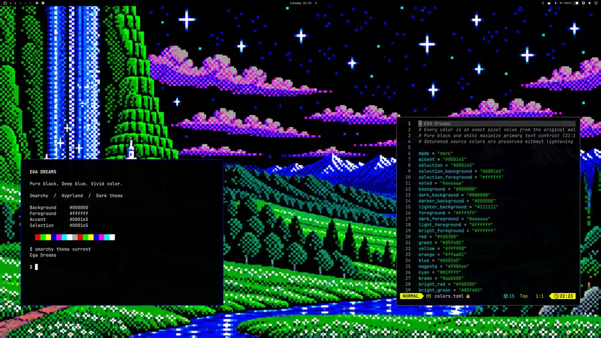

# EGA Dreams

A dark, high-contrast [Omarchy](https://omarchy.org/) theme with a dithered fantasy landscape, pure black surfaces, white text, and deep electric blue accents.



## Install

```bash
omarchy theme install https://github.com/Matt1656/omarchy-ega-dreams-theme
omarchy bar transparent false
```

The second command makes the bar fully opaque. Omarchy stores bar transparency as a desktop preference, separately from theme colors. The theme supplies a solid black bar background.

Select it again with:

```bash
omarchy theme set "EGA Dreams"
```

## Palette

The palette pairs deep blue accents and vivid EGA-style colors with a fantasy landscape wallpaper. No colors are lightened, blended, or desaturated. White text on black has a 21:1 contrast ratio.

| Role | Color |
| --- | --- |
| Background | `#000000` |
| Text | `#ffffff` |
| Accent and selection | `#0001e5` |
| Red | `#fd0300` |
| Green | `#05f405` |
| Yellow | `#ffff00` |
| Magenta | `#f90fe6` |
| Cyan | `#01ffff` |

`colors.toml` defines the palette. Omarchy generates its application configurations from it. `shell.bar.toml` preserves the opaque black bar styling. The [original wallpaper](backgrounds/ega-dreams.png) is included unchanged.

## Credits and license

Theme palette and packaging by [Matt1656](https://github.com/Matt1656), saved on September 22, 2026, using Omarchy 4.0.4. Shell bar styling is based on Omarchy's generated defaults. Theme configuration is distributed under [GPL-3.0](LICENSE).

The wallpaper was supplied with this theme and is separate from the configuration license; no ownership of third-party artwork or depicted characters is claimed.
